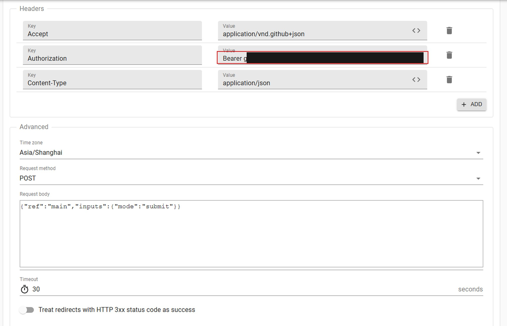

# 电子科技大学自动打卡（无硬件版）

每晚自动完成「晚安成电」打卡。**不需要电脑常开、不需要 ESP32、不需要安卓手机挂着。**

跑在 GitHub Actions 的免费 runner 上，每天北京时间 21:20 自动执行。

> 本项目基于 [fanrea/uestc-checkin-actions-public](https://github.com/fanrea/uestc-checkin-actions-public)
> 与 [richard297779/UESTC-MoonCheck](https://github.com/richard297779/UESTC-MoonCheck) 的工作，
> 把后者的应用宝协议实现移植为纯 Python。详见[致谢与来源](#致谢与来源)。

---

## 它是怎么做到的

平台从 2026-10-23 起要求打卡携带微信小程序签发的操作票据，票据源头是 `wx.login` code。

社区普遍认为 code 只能由微信运行时产生，所以常见方案是「注入微信进程抓会话」或「用旧手机抓票中转」——前者会被微信的反调试静默终止，后者需要常驻设备。

但腾讯应用宝（YYB）PC 端本身就是腾讯官方运营的**非微信运行时**，它的开放协议允许为任意小程序申请登录 code。本项目把这个协议用纯 Python 实现，于是整条链变成纯 HTTP，可以跑在任何能上网的机器上。

身份仍然是你本人：微信扫码授权，微信真实签发 code，学校服务端正常验票。改变的只是产生 code 的运行时，和你在电脑上用微信登录应用宝是同一件事。

---

## 你会用到的东西

| 项目 | 说明 |
| --- | --- |
| GitHub 账号 | 免费，用来跑定时任务 |
| **Chrome 或 Edge 浏览器** | **推荐**。需要用它打开开发者工具（F12）查看 Cookie 和网络请求，其他浏览器面板位置不同 |
| 你的微信 | 只需扫码授权一次 |
| 学号 + 统一身份认证密码 | 打卡平台登录用 |
| 常开设备 | **不需要** |

---

## 四步上手

全程在浏览器里完成，**不需要安装任何软件**。

### 第 1 步：拿一份自己的代码

点仓库右上角 **Fork**，或 **Use this template** → Create a new repository。

**强烈建议设为 Private。** 公开仓库的 Actions 日志任何人都能看。

### 第 2 步：打开配置向导

访问 **<https://justin1233321.github.io/UESTC-Auto-Checkin/>**。

> 如果你 Fork 了自己的仓库，也可以直接用浏览器打开自己仓库里的 `docs/index.html`（下载后双击即可），效果完全相同。向导是纯前端页面，不依赖任何服务器。

向导会引导你填四项信息：

1. **微信扫码授权** — 点按钮打开授权页，用本人微信扫码
2. **粘贴凭据** — 从浏览器 Cookie 里复制 `openid`、`accesstoken`、`refreshtoken`
3. **填宿舍坐标** — 必须现场取，向导会实时算出是否在围栏内
4. **填学号密码** — 统一身份认证的账号，顺便取浏览器指纹

填完后点「生成配置」，得到两段 JSON。

#### 微信凭据怎么取

扫码完成后，在授权页按 F12：

1. Application（应用程序）→ 左侧 Cookies → 点开 `static.pc.yyb.qq.com`
2. 找到 `openid`、`accesstoken`、`refreshtoken`，复制它们的 Value

> **复制完立刻关掉那个授权页面。** 同一组凭据只能有一个客户端保活，页面开着会和自动任务互相挤掉。

#### 宿舍坐标怎么取

在宿舍用浏览器打开 <https://jzsz.uestc.edu.cn/daily-checkin-h5/index.html?appId=294> 并登录：

1. F12 → **Network（网络）**
2. 过滤框输入 `reverse`
3. 找到 `map/reverse?lat=...&lng=...`，URL 里的 `lat` 和 `lng` 就是坐标

向导会自动算出你离打卡点中心多少米，超出 150 米会提示重取。

#### 浏览器指纹怎么取

决定 CAS 登录要不要短信验证。用你**平时打卡的那个浏览器**登录 <https://jzsz.uestc.edu.cn/>：

1. F12 → Application → Cookies → `https://idas.uestc.edu.cn`
2. 找 `MULTIFACTOR_BROWSER_FINGERPRINT`，复制 32 位十六进制值

它是 HttpOnly，`document.cookie` 看不到，必须用 Application 面板。

> 如果登录时弹了二次验证，勾选「信任此浏览器」再通过，之后这个指纹才会被认作可信设备。

### 第 3 步：添加两个 Secrets

去仓库 **Settings → Secrets and variables → Actions → New repository secret**，添加两个：

| Secret 名称 | 值 |
| --- | --- |
| `CHECKIN_CONFIG` | 向导生成的第一个 JSON（微信凭据 + 坐标） |
| `CAS_ACCOUNT` | 向导生成的第二个 JSON（学号 / 密码 / 指纹） |

就这两个，没有别的了。

**不需要创建 PAT。** 微信的 `refresh_token` 会轮换，本项目用 GitHub Actions 的 cache 保存新值，不依赖额外权限。缓存丢失时会回落到 Secret 里的初始凭据，只要 refresh token 还有效就能自愈。

> 向导生成的 JSON 里 `expires_at` 是 `0`，这是有意的：首次运行时程序会自动刷新凭据并写入缓存，你不需要做任何时间换算。

### 第 4 步：验证并配置定时

去 **Actions → Daily check-in → Run workflow**，依次跑：

**① mode 选 `validate`** — 只跑离线自检，不碰平台。绿了说明代码和环境正常。

**② mode 选 `ticket`** — 真实取码换票，但**不提交打卡**。成功输出 `ticketLength: 43`。白天也能跑，不消耗打卡机会。

**③ mode 选 `submit`** — 必须在 **21:00–23:30** 之间跑，这才真正打卡。

三步都通过后，配置外部定时触发，见下节。

### 第 5 步：配置外部定时触发

GitHub 自带的 `schedule` 不可靠（会延迟数小时甚至完全不触发），本项目已停用，改用外部定时服务调用 API 触发 workflow。

用 [cron-job.org](https://cron-job.org)（免费）每天在打卡窗口内多次调用。

**第一步：创建一个 PAT**

1. 点右上角**你自己头像** → Settings
2. 左侧栏拉到最底 → Developer settings
3. Personal access tokens → **Fine-grained tokens** → Generate new token
4. 按下表填写：

| 字段 | 值 |
| --- | --- |
| Token name | 随便起，比如 `uestc-checkin` |
| Expiration | 建议 90 天或更久（过期后需重新创建并更新） |
| Repository access | Only select repositories → 只选你的打卡仓库 |
| Repository permissions | 展开后找到 **Actions**，设为 **Read and write** |

生成后复制，形如 `github_pat_xxx`。**这个值只会显示一次**，关掉页面就再也看不到了。

> 权限只需要 **Actions: Read and write** 这一项，其他都不用给。

**第二步：在 cron-job.org 建任务**

注册后点 **Create cronjob**，按下表填：

| 字段 | 值 |
| --- | --- |
| Title | `UESTC checkin` |
| URL | `https://api.github.com/repos/你的用户名/你的仓库名/actions/workflows/checkin.yml/dispatches` |
| Execution schedule | **Every day at** `21` : `05` |
| Timezone | `Asia/Shanghai` |

> URL 里用的是 workflow 文件名 `checkin.yml`，不是数字 ID。文件名对所有仓库都一样，直接照抄即可，不需要查。

> **时区是关键。** cron-job.org 支持逐任务设置时区，界面右下角会显示
> `In this job's individual timezone (Asia/Shanghai)`。
>
> - 时区设为 `Asia/Shanghai` → 填 `21:05` / `21:50` / `22:35` / `23:20`
> - 时区保持 `UTC` → 填 `13:05` / `13:50` / `14:35` / `15:20`
>
> 两种都可以，但**千万别混**。填完看右侧 **Next executions** 预览，
> 它显示的就是真实执行时间。如果填的是 21:05 却预览成 `1:05 PM`，
> 说明时区是 UTC，改成 Shanghai 或把时间改成 13:05。

**Advanced** 标签页里设置：

| 字段 | 值 |
| --- | --- |
| Time zone | `Asia/Shanghai` |
| Request method | `POST` |
| Request body | `{"ref":"main","inputs":{"mode":"submit"}}` |
| Headers | 见下图，三行 |



上图中 `Authorization` 的值填 `Bearer ` 加上你刚创建的 PAT（图中已打码）。
三个 Header 分别是：

- `Accept`: `application/vnd.github+json`
- `Authorization`: `Bearer github_pat_xxx`
- `Content-Type`: `application/json`

保存后点 **TEST RUN**，看到 `HTTP 204` 就说明通了。随后去 Actions 页面确认有新的运行记录。

**第三步（可选）：再建 3 个提高容错**

到这一步已经能用了。单个任务每天 21:05 触发一次即可完成打卡。

如果想更稳，可以照同样方式再建 3 个，时间分别是 `21:50`、`22:35`、`23:20`（时区同为 Asia/Shanghai）。这样万一某次触发失败，后面还有机会补上。

多个任务幂等，第一个成功后其余会秒退，不会重复打卡。

配置完成后，每天 21:05 起会真实触发，不再依赖 GitHub 的调度器。

---

## 日常怎么用

**什么都不用做。** 窗口内会自动跑，见上节的四个触发点。

想确认结果，去 Actions 页面点最近一次运行，看 `Run check-in` 步骤：

| 输出 | 含义 |
| --- | --- |
| `"stage": "checkin_accepted"` | 打卡成功 |
| `"stage": "already_checked_in"` | 当天已打过，自动跳过（正常，四个触发点里后三个通常都是这个） |
| `"stage": "outside_window"` | 当前不在窗口内，**未提交**（正常，不是错误） |
| `"stage": "cas_login"` + 401 | 密码错了，或改了密码没更新 Secret |
| `refresh rejected` / `403` | 微信授权失效，需要重新扫码 |
| `"stage": "checkin_rejected"` + `code: 4006` | 服务端认为不在窗口（通常是调度延迟到窗口外） |

---

## 出问题怎么办

| 现象 | 原因与处理 |
| --- | --- |
| `Missing secrets: ...` | 有 Secret 没配，看提示补上（只有两个：`CHECKIN_CONFIG`、`CAS_ACCOUNT`） |
| `config missing openid/access_token` | `CHECKIN_CONFIG` 内容不完整，用向导重新生成 |
| `cas config missing student_id` | `CAS_ACCOUNT` 内容不完整，用向导重新生成 |
| `refresh rejected` / `403` 反复出现 | 微信授权失效，重新扫码走第 2 步 |
| `cas_login` 返回 401 | 密码不对，或改过密码没更新 `CAS_ACCOUNT` |
| 打卡被判异常 / 距离过大 | 坐标不在围栏内，回宿舍重取 |
| 定时任务不跑 | 检查 cron-job.org 任务是否启用；检查 Actions 是否被停用 |
| `ticket_rejected` | 学校 Cookie 和微信账号不是同一个人，或票据过期 |

---

## 安全须知

- 微信凭据（`openid` / `accesstoken` / `refreshtoken`）等同于你微信的登录授权。**只放 GitHub Secrets，不要提交到 Git、不要发群、不要截图。**
- 学号密码同理。本项目只在 Actions 的临时目录里使用，作业结束即删除。
- 所有日志只输出阶段名、HTTP 状态、整数业务码和长度，不输出凭据、code、票据、坐标或响应原文。
- `today` 接口的响应含姓名、学号、手机号和辅导员联系方式，代码只解析 9 个白名单字段，不整包落盘。
- 设备遗失或凭据疑似泄露时，去应用宝授权管理里撤销授权，重新扫码。

---

## 已知限制

- **协议维护风险**：微信若改版 MMTLS，取码会失效。YYB 生态是多项目共同维护，跟进成本低于单点逆向微信二进制，但不保证永久可用。
- **凭据会过期**：`refresh_token` 轮换失败时需要重新扫码，这是授权模型决定的，不是 bug。
- **围栏限制**：坐标固定，人不在宿舍范围内打卡会被判异常。本项目不做位置伪造。
- **定时延迟**：GitHub 的 cron 不保证准时，实测有过数小时延迟。本项目用窗口内四个触发点 + 窗内等待来缓解，但仍无法完全避免极端延迟。
- **未打卡会体现为失败**：如果某天所有触发点都落在窗口外，作业会标红（`outside_window`）。这是有意的——不打卡应该让你知道，而不是静默通过。看到红叉请手动补打。
- **同一组凭据只能一个客户端用**：部署后不要再开着扫码页面，也不要同时跑本地测试和 Actions。

---

## 仅供本人使用

本项目按电子科技大学「晚安成电」平台实现，其他学校平台不同，需自行适配。

自动化打卡**可能不符合学校规定**，请自行评估并承担后果。不要用它代替他人打卡，不要用于营利。

---

## 目录结构

```text
uestc_wx/
  crypto.py     哈希 / HKDF / AES-GCM / ECDH / varint / protobuf / LZ4
  wire.py       MMTLS 记录帧、握手、密钥派生、WPKG、ManualAuth、js-login
  dns.py        微信 HTTPDNS + 明文 HTTP/1.0 客户端
  mmtls.py      连接编排：握手 → ManualAuth → 0-RTT 取码
  yyb.py        应用宝 HTTPS：凭据刷新 + login_buffer
  platform.py   CAS 登录、门户预热、两段式换票、打卡提交
  flow.py       主流程编排 + 配置加载
  cli.py        命令行入口
docs/
  index.html    网页配置向导（纯前端，可直接用浏览器打开）
tools/
  setup_wizard.py   本地配置向导（可选，命令行版）
  trigger_helper.py 生成外部定时触发配置
tests/
  test_vectors.py   38 项黄金向量对拍（离线，无需账号）
```

---

## 本地工具（可选）

纯云端部署不需要装任何东西。以下工具只在需要排查问题时用：

```powershell
python -m venv .venv
.\.venv\Scripts\python.exe -m pip install -r requirements.txt
.\.venv\Scripts\python.exe -m uestc_wx.cli selftest
```

`selftest` 在 CI 里每次都会跑，本地跑只是确认环境正常。真正的价值在于：打卡失败时本地能立刻看到完整 traceback、能改代码重试，比对着 Actions 日志猜快得多。

本地调试完整流程：

```powershell
# 用网页向导生成的两个 JSON 存为 config.json 和 cas.json
.\.venv\Scripts\python.exe -m uestc_wx.cli ticket --config config.json
.\.venv\Scripts\python.exe -m uestc_wx.cli checkin --config config.json --cas-config cas.json --dry-run
```

---

## 致谢与来源

本项目是站在三个项目肩上做的，请注意各自的角色和许可。

### [fanrea/uestc-checkin-actions-public](https://github.com/fanrea/uestc-checkin-actions-public) — 起点

这是本项目最初的起点。它确立了「微信 code → Ticket → 打卡」这条链路，
以及「Windows 采集 + 云端重放」的整体架构，并提供了学校侧的字段契约、
`checkin-request-profile` 配置格式、以及那套脱敏日志的约定（只输出阶段、
HTTP 状态、整数业务码，不输出凭据与位置）。

本项目沿用了它的学校侧接口认知和隐私处理思路，但**鉴权方式完全不同**：
它依赖注入 Windows 微信进程抓取会话（绑定微信 4.1.15.56 / RadiumWMPF 25799，
需 Frida 注入原生偏移），本项目改用应用宝开放协议，因此不再需要 Windows 微信、
不再绑定微信版本、也不再受微信反调试影响。

如果你只想在 Windows 上跑、且微信版本恰好匹配，可以优先考虑原项目。

### [richard297779/UESTC-MoonCheck](https://github.com/richard297779/UESTC-MoonCheck)（MIT） — 协议实现

本项目 `uestc_wx/` 下的协议栈（`wire.py` / `mmtls.py` / `crypto.py` /
`dns.py` / `yyb.py`）移植自该项目的 ESP32 C++ 固件实现。
它首次证明了这个关键洞察：`wx.login` code 不必由微信运行时产生，
应用宝 PC 端作为腾讯官方运营的非微信运行时，同样能签发。

它同时也提供了本项目最重要的验证手段：`golden_vectors.h` 与
`aesgcm_vectors.h` 里的测试向量，让协议移植可以离线逐字节对拍，
而不必等到联网才发现握手错误。

### [moon-uestc](https://github.com/MioYiSama/moon-uestc) 与 YYB-Go-Enhanced

MoonCheck 的协议实现本身移植自 `moon-uestc`，并与 `YYB-Go-Enhanced` 的 Go 参考逐字节一致。
本项目是这条移植链的第三环：C++ → Python。

### 本项目的贡献

把上述协议用纯 Python 重写，并补齐了脱离硬件运行所需的部分：

- 38 项黄金向量对拍测试，保证移植正确性
- 真实服务器验证：MMTLS 握手、ManualAuth、0-RTT 取码、两段式换票
- 两段式换票（`check-bind` + `checkin-ticket`）与入口票据的完整实现
- 凭据轮换的持久化（回写 GitHub Secret），这是无状态 runner 长期运行的前提
- 配置向导与面向非开发者的文档

### 许可

本项目与原项目均为 MIT License。

